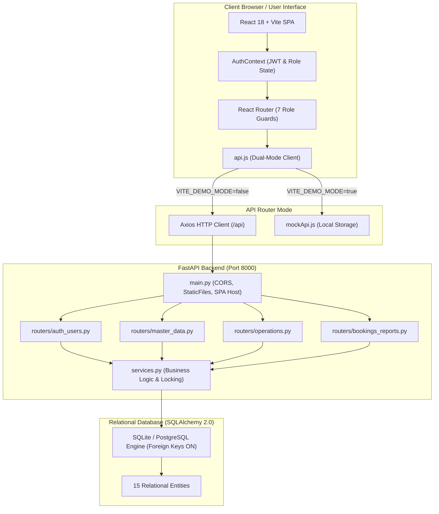
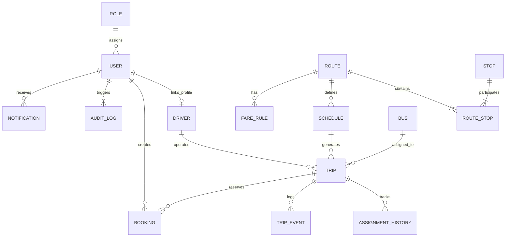

# CityTransit — City Bus Management System
## Complete System Documentation & Technical Reference

> **TRAINING & DEMO DISCLAIMER**: CityTransit is a fictional demonstration web application for municipal bus operations, passenger booking, fleet management, and operational reporting. It does not interface with live transit vehicles, actual GPS hardware, or real monetary payment gateways.

---

## 1. System Architecture Overview

CityTransit is built using a decoupled **Single-Page Application (SPA)** frontend connected to a high-performance **REST API** backend with ACID-compliant relational persistence.



### Key Architectural Strengths
1. **Single-Port Production Serving**: FastAPI directly serves the compiled React production bundle (`dist/`) at `/` and client routes (`/login`, `/trips`, `/bookings`, etc.) with `Cache-Control: no-store` headers, while exposing API endpoints at `/api/*` and interactive Swagger docs at `/docs`.
2. **Dual-Mode Frontend**: 
   - **Connected Mode (`VITE_DEMO_MODE=false`)**: Talks directly to FastAPI with JWT tokens, transaction locks, and relational constraints.
   - **Standalone Mode (`VITE_DEMO_MODE=true`)**: Intercepts requests with `mockApi.js` to allow full UI exploration without starting the Python backend.
3. **Transaction Safety**: Concurrent booking capacity checks utilize pessimistic locking (`with_for_update` on PostgreSQL, atomic SQLite row locks) to guarantee that bookings never exceed bus seating capacity.

---

## 2. Roles, Permissions & RBAC Matrix

The system enforces 7 distinct operational roles across both frontend navigation and server-side route decorators (`require_roles(...)`):

| Role | Responsibilities | Default Demo Account |
| :--- | :--- | :--- |
| **Administrator** | Full system control, user CRUD, system configuration, bus/route/schedule creation, and audit reviews. | `admin@citytransit.demo` |
| **Transport Manager** | Route planning, stop sequence ordering, schedule publishing, trip batch generation, and fleet reporting. | `manager@citytransit.demo` |
| **Dispatcher** | Daily dispatch console, assigning buses & drivers to trips, resolving conflicts, and updating trip statuses. | `dispatcher@citytransit.demo` |
| **Driver** | Scoped console viewing only assigned trips, recording departure/arrival times, delay notes, and passenger counts. | `driver1@citytransit.demo` |
| **Booking Clerk** | Passenger desk search, manual counter bookings, cancellations, and passenger attendance management. | `clerk@citytransit.demo` |
| **Passenger** | Public route search, interactive 2+2 visual bus seat selection, booking creation, and demo E-Ticket downloads. | `passenger@citytransit.demo` |
| **Auditor / Viewer** | Read-only access to operational KPI reports, route schedule analytics, and system-wide audit logs. | `auditor@citytransit.demo` |

*(All demo accounts use password: `demo123`)*

### RBAC Permission Matrix

| Feature / Action | Admin | Manager | Dispatcher | Driver | Clerk | Passenger | Auditor |
| :--- | :---: | :---: | :---: | :---: | :---: | :---: | :---: |
| **View Operations Dashboard** | Yes | Yes | Yes | Own | Yes | — | Yes |
| **Manage Users (CRUD + Delete)** | Yes | — | — | — | — | — | — |
| **Fleet & Bus Master Data** | Yes | Yes | Yes | — | — | — | View |
| **Driver Master Data** | Yes | Yes | Yes | — | — | — | View |
| **Routes & Stops Master Data** | Yes | Yes | Yes | — | — | — | View |
| **Schedules & Batch Trip Gen** | Yes | Yes | Yes | — | — | — | View |
| **Assign Bus & Driver to Trip** | Yes | Yes | Yes | — | — | — | — |
| **Update Trip Lifecycle Status** | Yes | Yes | Yes | — | — | — | — |
| **Record Driver Trip Events** | Yes | Yes | Yes | Own | — | — | — |
| **Public Trip Search** | Yes | Yes | Yes | Yes | Yes | Yes | Yes |
| **Create Passenger Booking** | Yes | Yes | Yes | — | Yes | Yes | — |
| **Cancel Own Booking (<30m)** | Yes | Yes | Yes | — | Yes | Own | — |
| **Operational Reports & CSV** | Yes | Yes | Yes | — | Yes | — | Yes |
| **Audit Logs Viewer** | Yes | Yes | — | — | — | — | Yes |

---

## 3. Visual System Walkthrough (Screenshots & UI Guide)

The system features a modern RedBus & AbhiBus-inspired design system with rich travel photography, crimson and slate accents, responsive layouts, and interactive modals.

### 3.1 Split-Screen Authentication & 1-Click Role Logins

- **Features**:
  - Full-screen split layout featuring high-resolution CityTransit bus photography.
  - Quick **Sign In** and **Passenger Sign Up** tab toggles with show/hide password controls.
  - **7 One-Click Demo Role Cards** allowing immediate testing as Administrator, Transport Manager, Dispatcher, Driver, Booking Clerk, Passenger, or Auditor without manual typing.
  - Demo security badge explicitly noting the fictional environment.

---

### 3.2 Operations Dashboard & Analytics

- **Features**:
  - **Role-Aware Header**: Dynamic breadcrumbs, live role badge, and in-app notifications dropdown with unread badge count.
  - **Travel Promotional Banner**: Photographic hero strip with *"Explore trips"* call-to-action and seasonal offers ribbon.
  - **Real-Time KPI Cards**: Daily scheduled trips, completed trips, delays, cancellations, and active bookings.
  - **Fleet Readiness & Driver Duty**: Real-time progress bars tracking bus availability and unassigned trips.
  - **Route Bookings Chart**: Recharts bar graph visualizing passenger ticket distribution across routes.
  - **Recent Events Timeline**: Operational activity stream tracking departure and assignment logs.

---

### 3.3 RedBus / AbhiBus Passenger Search Hero

- **Features**:
  - **Interactive Search Console**: Origin, Destination, and Travel Date selectors with a 1-click **City Swap** button (`⇆`).
  - **Quick Date Chips**: One-click **Today** and **Tomorrow** pills automatically synchronized to local timezone.
  - **Filter Shortcuts**: Filter trips by bus type (`All`, `AC Seater`, `Non-AC`, `Electric`).
  - **Trip Cards**: Displays route origin $\rightarrow$ destination, distance note, live departure/arrival estimates, fare, remaining seat capacity, and intermediate stops timeline.

---

### 3.4 Interactive 2+2 Visual Bus Seat Selection Map

- **Features**:
  - **Deck Layout**: Visual 2+2 seat configuration modeled after modern intercity transit coaches.
  - **Driver Cabin Reference**: Front-of-bus orientation indicator for passenger clarity.
  - **Real-Time Seat States**: Distinct color-coded visual states for `Available` (emerald outline), `Selected` (crimson active), and `Occupied` (muted grey).
  - **Automatic Fare Calculation**: Dynamically updates total price as seats are toggled.
  - **Boarding Stop Selector**: Allows passengers to choose their specific pickup stop along the route.

---

### 3.5 Bookings Management & Horizontal Grid

- **Features**:
  - **Wide Scrollable Grid (`.bookings-wide-table`)**: Ensures full column access (Reference, Passenger, Contact, Route, Trip, Fare, Status, Attendance, Actions) across desktop and mobile.
  - **Attendance Status Management**: Booking clerks can record passenger boarding or flag no-shows.
  - **30-Minute Cutoff Policy Notice**: Clear advisory highlighting that cancellations are permitted up to 30 minutes before departure.
  - **Delete Actions**: Referential integrity checks release seats back to the trip when a booking is deleted.

---

### 3.6 Printable Demo mTicket / Boarding Pass

- **Features**:
  - **Clean Boarding Pass Format**: Displays booking reference code, passenger name, contact number, route, travel date, UTC departure time, and seat labels.
  - **Payment & Trip Status**: Verified with mock payment status badge (`Demo Paid`).
  - **One-Click Browser Print**: Formatted with dedicated `@media print` CSS rules hiding menus and buttons for clean paper or PDF printing.

---

### 3.7 Trips & Dispatch Operations Console

- **Features**:
  - **Dispatch Management**: Dispatchers can assign or reassign eligible buses and drivers to scheduled trips.
  - **Overlap Validation Alert**: Rejects conflicting assignments if a bus or driver has an overlapping time window.
  - **Lifecycle Status Actions**: Progresses trips through `Scheduled` $\rightarrow$ `Assigned` $\rightarrow$ `Boarding` $\rightarrow$ `In Progress` $\rightarrow$ `Completed`.
  - **Driver Event Logging**: Drivers record actual departure/arrival times, categorized delays, and passenger counts.

---

### 3.8 Analytics & Operational Reports

- **Features**:
  - **Multi-Tab Analytics**: Switch between **Trip Operations**, **Booking Summary**, **Bus Utilization**, **Route Schedule**, **Driver Assignment**, **Cancellations**, and **Audit Logs**.
  - **Interactive Visualizations**: Recharts status distribution charts and utilization comparison bars.
  - **Comprehensive FilterBar**: Filter by service date, route, bus, driver, and trip status.
  - **CSV Export & Print**: One-click CSV generation of filtered datasets and print-optimized view.

---

### 3.9 Fleet & Bus Master Data Management

- **Features**:
  - **Fleet Roster**: Bus number, demo registration, capacity, bus type, and operational status (`Available`, `Assigned`, `Maintenance`, `Inactive`).
  - **Inline Editing & Modals**: Transport Managers can update capacity, maintenance flags, or active states.
  - **Row-Level Delete Protection**: Deletion is blocked with an informative alert if the bus is currently assigned to an active trip.

---

### 3.10 Interactive FastAPI Swagger / OpenAPI Documentation

- **Features**:
  - **Live OpenAPI 3.1 Console**: Directly accessible at `/docs`.
  - **Interactive Testing**: Test any endpoint with Bearer token authentication directly in the browser.
  - **Strict Schema Documentation**: Complete Pydantic v2 request body models and JSON error responses.

---

## 4. Relational Database Schema & Entities

The relational database model comprises 15 SQLAlchemy entities:



### Entity Summary
1. **`roles`**: System roles (`Administrator`, `Transport Manager`, etc.).
2. **`users`**: System users, PBKDF2 password hash, role foreign key, and active flag.
3. **`buses`**: Fleet vehicles, registration number, seating capacity (e.g. 40 seats), bus type (`AC Seater`, `Non-AC`, `Electric`), operational status (`Available`, `Assigned`, `Maintenance`, `Inactive`).
4. **`drivers`**: Drivers, employee code, license reference, contact number, status (`Available`, `Assigned`, `On Leave`, `Inactive`), optional linked user ID.
5. **`routes`**: Bus routes, code (`R-01`), name, origin, destination, distance note, active status.
6. **`stops`**: Bus stops, stop code (`ST-001`), name, area/neighborhood, active status.
7. **`route_stops`**: Junction table establishing ordered stop sequences with unique constraint `(route_id, sequence)` and estimated offset minutes.
8. **`schedules`**: Master timetables, departure time, duration minutes, default fare, service day rules (`Daily`, `Mon-Sat`), published flag.
9. **`fare_rules`**: Route-specific fare overrides with effective dates.
10. **`trips`**: Generated service trips, trip number (`TR-2601`), service date, departure timestamp, arrival timestamp, assigned bus ID, assigned driver ID, status (`Scheduled`, `Assigned`, `Boarding`, `In Progress`, `Completed`, `Delayed`, `Cancelled`), passenger count.
11. **`assignment_history`**: Audit trail of every bus and driver assignment change with actor and reason.
12. **`trip_events`**: Operational timeline events (departure, arrival, delay category, delay note, passenger count updates).
13. **`bookings`**: Passenger ticket reservations, unique reference (`BK-XXXXX`), passenger name, demo contact, seat quantity, total fare, payment status (`Demo Paid`), idempotency key, status (`Confirmed`, `Cancelled`, `Completed`, `No-show`).
14. **`audit_logs`**: System audit trail capturing actor, action, entity type, entity ID, description, timestamp.
15. **`notifications`**: Targeted staff and passenger in-app alerts with read status.

---

## 5. Core Business Logic & Safeguards

### 5.1 Route Publishing Safeguards
- A route **must contain at least 2 distinct active stops** before any schedule referencing it can be published or used to generate trips.
- Stop sequence numbers must be unique per route.

### 5.2 Bus & Driver Overlap Conflict Prevention
- Before assigning a bus or driver to a trip, `check_bus_driver_overlap(...)` checks whether the bus or driver is already assigned to another non-completed/non-cancelled trip on the same service date whose travel time window overlaps.
- Inactive drivers, drivers on leave, and buses under maintenance cannot be assigned.
- Every assignment change creates an `AssignmentHistory` entry and a `TripEvent`.

### 5.3 Passenger Search & Visual Seat Selection
- Search hero allows swapping Origin and Destination with one click, selecting dates (with Today / Tomorrow quick chips), and filtering by bus type.
- The interactive **2+2 seat map** visualizes occupied vs. available seats with Driver cabin reference, allowing users to pick specific seat labels (e.g. `1A`, `1B`).

### 5.4 Transaction-Safe Booking & Capacity Lock
- When booking seats, the system queries the trip's bus capacity and current confirmed bookings within a database transaction.
- If `current_booked + requested_seats > capacity`, the transaction is rolled back and returns `409 Conflict` (`CAPACITY_EXCEEDED`).
- Submissions support an `idempotency_key` to prevent double-charging on duplicate network requests.

### 5.5 30-Minute Cancellation Cutoff Policy
- Passengers and staff may cancel a confirmed booking only if the trip's scheduled departure time is **at least 30 minutes in the future**.
- Cancelling releases the seats back to available capacity and writes to the audit trail.

### 5.6 Scoped Driver Trip Updates
- When a user with the `Driver` role queries trips, the backend filters results strictly to trips where `driver_id == current_user.driver_profile.id`.
- Drivers can log departure, arrival, delays (categorized: `Traffic`, `Mechanical`, `Weather`, `Breakdown`, `Other`), and passenger counts ($\le$ bus capacity). Drivers cannot alter routes, fares, or assignments.

### 5.7 Cascading Delete Protection
All 8 management pages include `<DeleteAction />` buttons that enforce referential integrity:
- Buses cannot be deleted if assigned to active trips.
- Drivers assigned to trips have their assignments cleared before deletion.
- Routes cannot be deleted if active schedules depend on them.
- Stops cannot be deleted if route sequences include them.
- Schedules cannot be deleted if trips have been generated.
- Trips cannot be deleted if confirmed passenger bookings exist.
- Bookings release their seat capacity upon deletion.
- Users cannot delete their own active session account.

---

## 6. REST API Reference

Interactive OpenAPI documentation is always available at: **`http://127.0.0.1:8000/docs`**.

### 6.1 Authentication & User Management
| Method | Endpoint | Description | Permitted Roles |
| :--- | :--- | :--- | :--- |
| `GET` | `/api/health` | System health check and mode indicator | Public |
| `POST` | `/api/auth/login` | Authenticate with email & password, returns JWT token | Public |
| `POST` | `/api/auth/register` | Register demo passenger account | Public |
| `GET` | `/api/auth/me` | Fetch currently authenticated user profile | Authenticated |
| `GET` | `/api/users/roles` | List all system roles | Admin, Manager |
| `GET` | `/api/users` | List paginated users with search & filters | Admin |
| `POST` | `/api/users` | Create user and assign role | Admin |
| `PATCH` | `/api/users/{user_id}` | Update user details, password, or active status | Admin |
| `DELETE` | `/api/users/{user_id}` | Delete user account (cannot self-delete) | Admin |
| `GET` | `/api/notifications` | List user's in-app notifications | Authenticated |
| `PUT` | `/api/notifications` | Mark notifications as read | Authenticated |

### 6.2 Master Data Management
| Method | Endpoint | Description | Permitted Roles |
| :--- | :--- | :--- | :--- |
| `GET` | `/api/buses` | List buses with search and status filters | Admin, Manager, Dispatcher, Auditor |
| `POST` | `/api/buses` | Register new bus in fleet | Admin, Manager |
| `PATCH` | `/api/buses/{bus_id}` | Update bus details, capacity, or status | Admin, Manager |
| `DELETE` | `/api/buses/{bus_id}` | Delete bus (blocked if assigned to trips) | Admin, Manager |
| `GET` | `/api/buses/{bus_id}/assignments` | View assignment history for bus | Admin, Manager, Dispatcher |
| `GET` | `/api/drivers` | List drivers with search and status filters | Admin, Manager, Dispatcher, Auditor |
| `POST` | `/api/drivers` | Register new driver profile | Admin, Manager |
| `PATCH` | `/api/drivers/{driver_id}` | Update driver details, status, or license | Admin, Manager |
| `DELETE` | `/api/drivers/{driver_id}` | Delete driver profile | Admin, Manager |
| `GET` | `/api/drivers/{driver_id}/assignments`| View assignment history for driver | Admin, Manager, Dispatcher |
| `GET` | `/api/stops` | List bus stops | Admin, Manager, Dispatcher |
| `POST` | `/api/stops` | Create new bus stop | Admin, Manager |
| `PATCH` | `/api/stops/{stop_id}` | Update stop name, area, or active status | Admin, Manager |
| `DELETE` | `/api/stops/{stop_id}` | Delete stop (blocked if linked to routes) | Admin, Manager |
| `GET` | `/api/routes` | List bus routes with stop counts | Admin, Manager, Dispatcher, Auditor |
| `POST` | `/api/routes` | Create route with origin & destination | Admin, Manager |
| `GET` | `/api/routes/{route_id}` | Get route details with ordered stop sequence | Admin, Manager, Dispatcher |
| `PATCH` | `/api/routes/{route_id}` | Update route details | Admin, Manager |
| `DELETE` | `/api/routes/{route_id}` | Delete route (blocked if schedules exist) | Admin, Manager |
| `GET` | `/api/routes/{route_id}/stops` | Fetch ordered stops for route | Authenticated |
| `PUT` | `/api/routes/{route_id}/stops` | Replace/re-order stops on route | Admin, Manager |

### 6.3 Schedules, Operations & Dispatch
| Method | Endpoint | Description | Permitted Roles |
| :--- | :--- | :--- | :--- |
| `GET` | `/api/schedules` | List schedules with route details | Admin, Manager, Dispatcher, Auditor |
| `POST` | `/api/schedules` | Create schedule for route | Admin, Manager |
| `PATCH` | `/api/schedules/{schedule_id}` | Update schedule or toggle published status | Admin, Manager |
| `DELETE` | `/api/schedules/{schedule_id}` | Delete schedule (blocked if trips exist) | Admin, Manager |
| `POST` | `/api/schedules/{schedule_id}/generate-trips` | Batch-generate trips for date range | Admin, Manager |
| `GET` | `/api/trips` | List trips (auto-scoped for Driver role) | Staff & Drivers |
| `GET` | `/api/trips/{trip_id}` | Get detailed trip operational profile | Staff & Drivers |
| `PATCH` | `/api/trips/{trip_id}/assignment` | Assign eligible bus & driver with conflict check | Dispatcher, Manager, Admin |
| `PATCH` | `/api/trips/{trip_id}/status` | Transition trip status | Dispatcher, Manager, Admin |
| `DELETE` | `/api/trips/{trip_id}` | Delete trip (blocked if bookings exist) | Dispatcher, Manager, Admin |
| `POST` | `/api/trips/{trip_id}/events` | Record departure, arrival, delay, pax count | Driver, Dispatcher, Manager, Admin |
| `GET` | `/api/trips/{trip_id}/bookings` | Follow-up bookings for cancelled trips | Staff |
| `GET` | `/api/public/trips/search` | Search published trips by origin, dest, date | Public |

### 6.4 Bookings, Dashboard & Analytics
| Method | Endpoint | Description | Permitted Roles |
| :--- | :--- | :--- | :--- |
| `POST` | `/api/bookings` | Book seats with capacity locking | Passenger, Clerk, Staff |
| `GET` | `/api/bookings` | List all bookings with search & status filters | Staff & Clerks |
| `GET` | `/api/bookings/me` | List authenticated passenger's own bookings | Passenger |
| `PATCH` | `/api/bookings/{booking_id}/cancel` | Cancel booking (enforces 30m cutoff) | Passenger (own), Staff |
| `PATCH` | `/api/bookings/{booking_id}/status` | Update booking status (`No-show`, etc.) | Clerk, Staff |
| `DELETE` | `/api/bookings/{booking_id}` | Delete booking and release seat capacity | Clerk, Admin, Manager |
| `GET` | `/api/dashboard/summary` | Real-time operations KPIs & route chart | Staff |
| `GET` | `/api/reports/trips` | Trip operations report | Staff & Auditor |
| `GET` | `/api/reports/route-schedules` | Route schedule report | Staff & Auditor |
| `GET` | `/api/reports/bookings` | Booking summary & revenue report | Staff & Auditor |
| `GET` | `/api/reports/bus-utilization` | Fleet capacity & utilization report | Staff & Auditor |
| `GET` | `/api/reports/driver-assignments`| Driver duty assignment report | Staff & Auditor |
| `GET` | `/api/reports/cancellations` | Cancellation reason audit report | Staff & Auditor |
| `GET` | `/api/audit-logs` | Immutable audit log trail | Admin, Manager, Auditor |

---

## 7. How to Run & Verify

### Method 1: Single-Command Quick Launch (Recommended)
From the project root:
```powershell
.\start.bat
```
*(Or simply run `python run.py`)*

The server starts on **`http://127.0.0.1:8000/`**.
- Web App UI: **`http://127.0.0.1:8000/`**
- Interactive Swagger API: **`http://127.0.0.1:8000/docs`**

### Method 2: Running Automated Tests
Run the complete test suite (RBAC security, lifecycle, concurrency locking, and negative validations):
```powershell
cd backend
.\.venv\Scripts\Activate.ps1
pytest -v backend/tests/
```
**Expected Result**: `9 passed in 26s` with 0 failures.

### Method 3: Optional Frontend Development Server
To run Vite with hot-module reloading:
```powershell
cd "City_Bus_Management_System_React_Frontend\City-Bus-Management-System-Frontend"
npm install
npm run dev
```
Open **`http://localhost:5173`** (proxies `/api` to port 8000).
To re-compile for production: `npm run build`.
